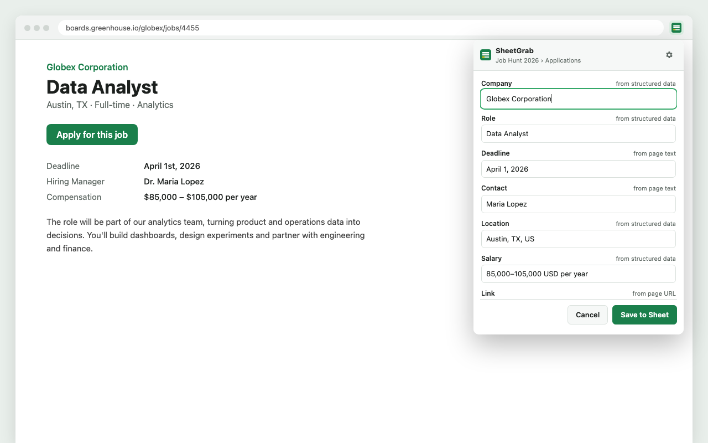
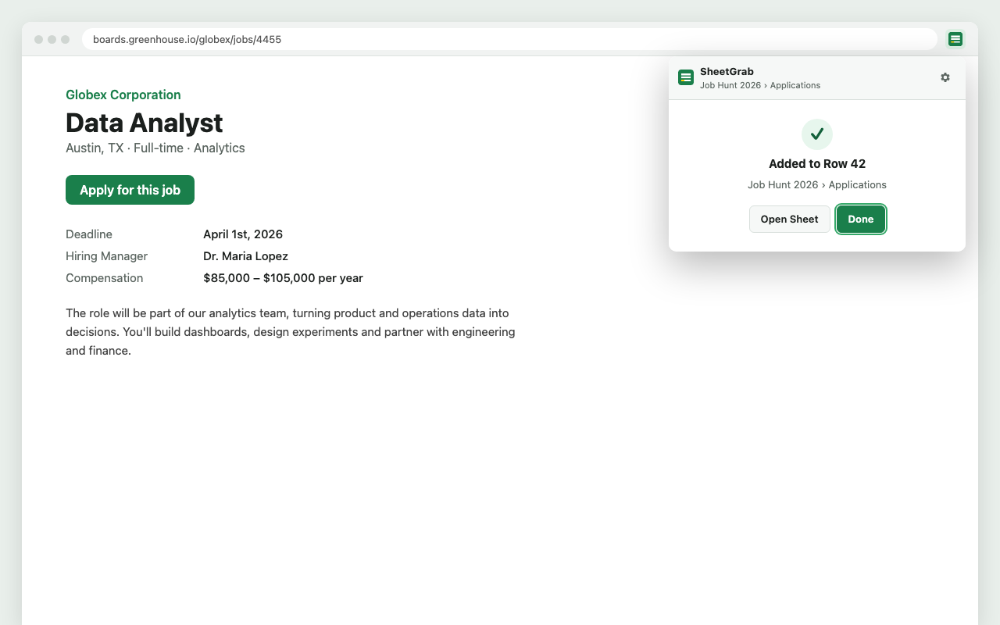
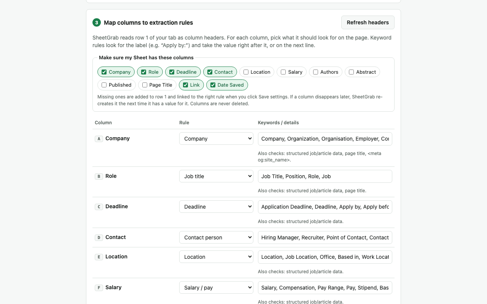

# SheetGrab

**Clip job postings, internships and research papers from any web page into your own Google Sheet, in one click.**

<p>
  <a href="https://chromewebstore.google.com/detail/piomlnckefcdoihgpfaijbfmjdoglnai"><strong>Install from the Chrome Web Store</strong></a>
  · <a href="https://arozhada.github.io/sheetgrab/">Website</a>
  · <a href="https://arozhada.github.io/sheetgrab/privacy.html">Privacy policy</a>
</p>

> **Status:** SheetGrab is currently in Chrome Web Store review. The store link goes live once it's approved. Until then, you can [run it from source](#run-from-source).



## What it does

Tracking applications in a spreadsheet? Open a job posting, click the SheetGrab icon, and the posting's details are already filled in: company, role, deadline, contact, location, salary, link and today's date. Check them, edit anything, and click **Save to Sheet**. A new row lands in your Google Sheet.

- **Works on any site.** SheetGrab doesn't depend on one website's layout. It looks for labels like "Deadline:", "Apply by", "Hiring Manager" or "Reach out to", and uses standard job and article metadata. It works on LinkedIn, Greenhouse, Lever, Workday, company career pages and research paper sites.
- **Fits your Sheet.** It reads your column headers and matches each one to the right field. It can also create any missing columns for you, and you can tweak the keywords for each column.
- **Private by design.** The page is read only when you click the icon. Data goes straight from your browser to your own Google Sheet. There are no SheetGrab servers, analytics or tracking.

| Saved to your Sheet | Map your columns |
| --- | --- |
|  |  |

## How to use it

1. **Install** SheetGrab from the [Chrome Web Store](https://chromewebstore.google.com/detail/piomlnckefcdoihgpfaijbfmjdoglnai). The settings page opens automatically. You can reopen it later by right-clicking the icon → **Options**.
2. Click **Connect Google Account**.
3. Paste the URL of your tracking Sheet, click **Load tabs**, and pick a tab.
4. Check the column mapping. SheetGrab reads row 1 as headers and guesses a rule for each one: "Apply By" becomes Deadline, "Link" becomes the page URL, and so on. Under **Make sure my Sheet has these columns**, tick any standard fields you want. Missing ones are added to row 1 when you click **Save settings**, so an empty Sheet works too.
5. On any job posting, click the SheetGrab icon, review the pre-filled fields, and click **Save to Sheet**. You'll see "Added to Row N".

Tips:
- Select part of a page before clicking the icon, and SheetGrab looks there first.
- Rows are written by header name, so you can reorder your columns freely.

### Extraction rules

| Rule | Looks at (in order) |
| --- | --- |
| Job title | JSON-LD title → "Job Title:/Position:/Role:" → page title |
| Company | "Company:/Organization:/Employer:" → JSON-LD hiringOrganization → page title → `og:site_name` |
| Deadline | "Deadline/Apply by/Closes on/…" + a date → JSON-LD validThrough |
| Contact person | "Hiring Manager/Recruiter/Contact/Reach out to…" → a name and/or email |
| Location, Salary | labels → JSON-LD jobLocation / baseSalary |
| Authors, Abstract, Published date | `citation_*` meta → JSON-LD article → labels |
| Page title, Page URL, Date saved | page metadata / today (links have tracking parameters removed) |
| Custom keywords | your labels, with a value type (date, person, email, text…) |
| Custom regex | first capture group (or the whole match) in the page text |

## Privacy and permissions

| Permission | Why |
| --- | --- |
| `activeTab`, `scripting` | Read the current page, only when you click the icon |
| `identity` | Sign in with Chrome's built-in Google sign-in |
| `storage` | Save your settings (Sheet, tab, column mapping) |
| `sheets.googleapis.com` | Read your header row and append rows. This is the only server SheetGrab talks to. |

SheetGrab has no broad host permissions and no servers of its own. Page values that start with `=`, `+`, `-` or `@` are saved as plain text, so a web page can't inject a spreadsheet formula. On pages Chrome doesn't let extensions read (such as `chrome://` pages or the Web Store), only the URL, title and date are filled in. Full details are in the [privacy policy](https://arozhada.github.io/sheetgrab/privacy.html).

Questions or problems? [Open an issue](https://github.com/ArozHada/sheetgrab/issues) or email sheetgrab@protonmail.com.

---

## Run from source

No build step and no dependencies. These are plain ES modules that Chrome loads directly.

1. Clone this repo.
2. Open `chrome://extensions`, turn on **Developer mode**, click **Load unpacked**, and select the repo folder.

The `key` in `manifest.json` gives the unpacked copy the same ID as the store version (`piomlnckefcdoihgpfaijbfmjdoglnai`), so it uses the published OAuth client.

**Forking?** Google sign-in is tied to that ID and client. To run your own copy:
1. Remove `key` from `manifest.json` and load the extension unpacked to get your own extension ID.
2. Create a Google Cloud project and enable the **Google Sheets API**.
3. Configure the OAuth consent screen: External, Testing status, add yourself as a test user, scope `https://www.googleapis.com/auth/spreadsheets`.
4. Create an OAuth client of type **Chrome Extension** with your extension ID.
5. Put that client ID in `manifest.json` → `oauth2.client_id` and reload the extension.

### Project layout

```
manifest.json
background/   service worker: OAuth token handling + Sheets API calls
content/      collectPageData(): injected on click, returns raw page text/meta/JSON-LD
lib/          extract.js (pure extraction engine), rules.js, storage.js, dom.js, messaging.js
popup/        the clipper form
options/      settings + column mapping
tests/        node --test unit tests with page fixtures
scripts/      package.mjs (store zip), screenshots.mjs (store images)
docs/         website + privacy policy (GitHub Pages), images, store-listing.md
```

```sh
npm test              # unit tests (Node 20+)
npm run package       # tests + dist/sheetgrab-<version>.zip for the Chrome Web Store
npm run screenshots   # dist/store/*.png (1280×800 screenshots + 440×280 promo tile)
```

To debug, open `chrome://extensions` and use **Inspect views: service worker** for background logs. Right-click the popup → **Inspect** for popup logs.

### Releasing an update

1. Bump `version` in `manifest.json`.
2. Run `npm run package`.
3. Upload `dist/sheetgrab-<version>.zip` on the item's **Package** tab in the [Chrome Web Store Developer Dashboard](https://chrome.google.com/webstore/devconsole).

The packaging script removes `key` from the upload (the store rejects it) and refuses to build if the tests fail or the OAuth client ID is a placeholder. Text for the store listing, privacy answers and OAuth verification is in [docs/store-listing.md](docs/store-listing.md).
